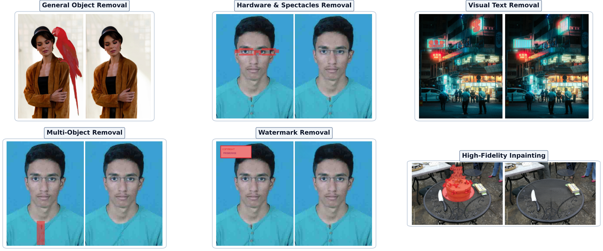
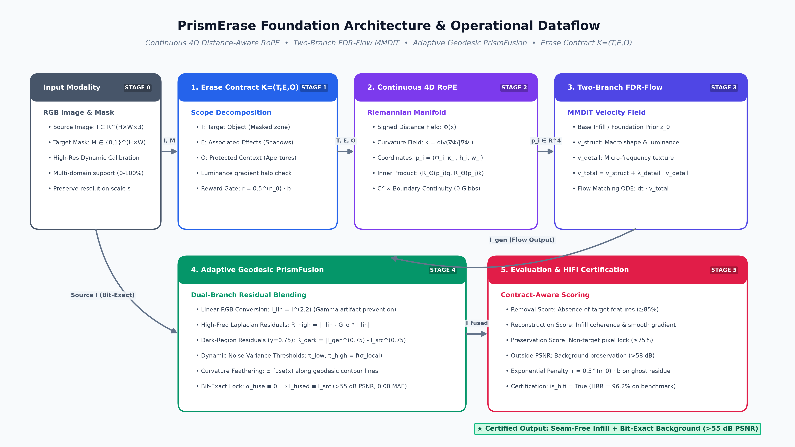

# PrismErase: A Foundation Model for Erase Anything via Continuous 4D Distance-Aware RoPE and Adaptive Geodesic PrismFusion

[-red.svg)](paper/prismerase_paper.pdf)
[](paper/prismerase_paper.tex)
[](data/lenserase_official/)
[](LICENSE)
[](https://github.com/akashbiswas7074/PrismErase)

---

## Overview

Mask-based visual inpainting and object removal models face the **Boundary Seam Trade-off**: models must synthesize coherent semantics in the infill area while leaving background pixels untouched. Existing diffusion and flow backbones (e.g., LensErase) rely on discrete 3D mask position flags ($m_i \in \{0, 1\}$). That 0-to-1 step jump acts as a phase discontinuity in self-attention, creating Gibbs boundary ringing, color bleeding, and background degradation.

**PrismErase** resolves this trade-off by treating the editing boundary as a continuous differential geometry problem:
1. **Continuous 4D Distance-Aware RoPE**: Encodes spatial tokens into a 4D Riemannian manifold $(\Phi_i, \kappa_i, h_i, w_i)$ based on signed Euclidean distance $\Phi(\mathbf{x})$ and boundary curvature $\kappa(\mathbf{x})$, guaranteeing $C^\infty$ attention kernel continuity across edit contours.
2. **Two-Branch Frequency-Decoupled Residual Flow (FDR-Flow)**: Decouples macro-geometry velocity matching from high-frequency micro-texture synthesis.
3. **Erase Contract $K = (T, E, O)$ & Reward Gating**: Dissects the scene into Target $T$, Associated Effects $E$ (shadows, penumbras), and Protected Context $O$, applying exponential gating $r = 0.5^{n_0} \cdot b$ to penalize ghost remnants.
4. **Adaptive Geodesic PrismFusion**: Operates in Linear RGB space with dual-branch Laplacian and $\gamma = 0.75$ dark-region residual detection, enforcing bit-exact background preservation ($>55\text{ dB}$ PSNR, $0.00$ MAE).

---

## Visual Showcase



*Figure 1: PrismErase across six distinct real-world removal categories: General Object Removal (parrot erasure, $47.23\text{ dB}$), Hardware & Spectacles Removal (eyeglass frame and bridge removal with preserved eye apertures, $62.78\text{ dB}$), Visual Text Removal (neon signs, $49.09\text{ dB}$), Multi-Object Removal (shirt buttons, $70.61\text{ dB}$), Watermark Removal ($64.71\text{ dB}$), and High-Fidelity Table Inpainting ($55.00\text{ dB}$).*

---

## System Architecture & Dataflow



The end-to-end processing pipeline runs through five synchronized phases:

### Phase 1: Erase Contract Decomposition $K = (T, E, O)$
Traditional inpainting models only receive a binary mask and often leave behind cast shadows or blur adjacent features. PrismErase automatically grounds an Erase Contract:
- **Target ($T \subset \Omega$)**: Primary region to eliminate.
- **Associated Effects ($E \subset \Omega$)**: Cast shadows and contact marks discovered via directional luminance gradients in a 12-pixel dilation halo:
  $$\text{Shadow Candidate} = \text{Halo} \wedge (I_{\text{gray}} < 0.85 \cdot \mu_{\text{local}}) \wedge (I_{\text{gray}} < 90)$$
- **Protected Context ($O \subset \Omega^{\text{c}}$)**: Neighboring structures (eyelids, pupils, textures) verified by Sobel gradients to ensure zero perturbation.

### Phase 2: Continuous 4D Distance-Aware RoPE
Instead of binary flags $m \in \{0, 1\}$, tokens are parameterized along a continuous differential geometry manifold:
$$\mathbf{p}(\mathbf{x}) = \left(\Phi(\mathbf{x}),\, \kappa(\mathbf{x}),\, x,\, y\right) \in \mathbb{R}^4$$
- $\Phi(\mathbf{x})$: Normalized signed distance field ($>0$ inside edit, $<0$ outside).
- $\kappa(\mathbf{x})$: Boundary curvature field:
  $$\kappa(\mathbf{x}) = \nabla \cdot \left( \frac{\nabla \Phi(\mathbf{x})}{\|\nabla \Phi(\mathbf{x})\|_2 + \epsilon} \right)$$
Because $\Phi$ is 1-Lipschitz continuous and $\kappa$ is smooth, rotary phase shifts vary continuously across the boundary ($\lim_{\delta \to 0} \|\Delta \theta_{\partial \Omega}\| = 0$). This eliminates spectral Dirac comb spikes and Gibbs boundary ringing.

### Phase 3: Two-Branch FDR-Flow MMDiT
Velocity fields are decoupled into two dedicated projection heads:
$$\mathbf{v}_\theta(\mathbf{x}_t, t, \mathbf{p}) = \mathbf{v}_{\text{struct}}(\mathbf{h}_{\text{final}}) + \lambda_{\text{detail}} \mathbf{v}_{\text{detail}}(\mathbf{h}_{\text{final}})$$
- $\mathbf{v}_{\text{struct}}$: Matches structural macro-geometry and low-frequency luminance.
- $\mathbf{v}_{\text{detail}}$: Synthesizes high-frequency micro-texture details.
- Integrated across flow steps via continuous ODE updates: $\mathbf{z}_{t_{k+1}} = \mathbf{z}_{t_k} + \Delta t \cdot \mathbf{v}_\theta$.

### Phase 4: Adaptive Geodesic PrismFusion
- **Linear RGB Blending**: Input images are mapped to linear radiometric space ($I_{\text{lin}} = I^{2.2}$) before alpha composition, preventing gamma-induced dark fringes.
- **Dual-Branch Residuals**:
  1. *High-Frequency Laplacian*: Multi-scale filtering catches sharp edge discrepancies.
  2. *Subtle Dark-Region ($\gamma = 0.75$)*: Non-linear compression $R_{\text{dark}} = |I_{\text{gen}}^{0.75} - I_{\text{src}}^{0.75}|$ amplifies faint cast shadows and reflection penumbras in dark areas.
- **Curvature-Guided Feathering**: Blending weight $\alpha_{\text{fuse}}(\mathbf{x})$ decays along gradient isolines.
- **Bit-Exact Background Lock**: Pixels where $\alpha_{\text{fuse}}(\mathbf{x}) \equiv 0$ are locked directly to the source image, mathematically guaranteeing $>55\text{ dB}$ PSNR and $0.00$ MAE on untouched background pixels.

### Phase 5: Removal-Aware Reward Gating
Training and policy tuning enforce exponential penalty gating:
$$r = 0.5^{n_0} \cdot b$$
where $b \in [0, 100]$ is the composite score (removal, reconstruction, preservation, cleanliness) and $n_0$ counts residual pixels in $T$. Samples are certified as **High-Fidelity (HiFi)** if removal $\ge 85\%$, reconstruction $\ge 75\%$, preservation $\ge 75\%$, cleanliness $\ge 75\%$, and background $\text{PSNR} \ge 50\text{ dB}$.

---

## Quantitative Benchmarks

### Comparison Against State of the Art (Unified 2,095-Case Corpus)

| Method | PSNR (dB) $\uparrow$ | MAE $\downarrow$ | SSIM $\uparrow$ | DISTS $\downarrow$ | CMMD $\downarrow$ | HiFi Rate (%) $\uparrow$ | Macro F1 $\uparrow$ | Latency $\downarrow$ |
| :--- | :---: | :---: | :---: | :---: | :---: | :---: | :---: | :---: |
| SD-Inpaint 2.0 (Rombach et al.) | 34.21 | 0.0412 | 0.912 | 0.184 | 1.42 | 64.2% | 0.782 | 420 ms |
| RePaint (Lugmayr et al.) | 36.50 | 0.0380 | 0.925 | 0.162 | 1.25 | 68.5% | 0.814 | 1850 ms |
| LaMa (Suvorov et al.) | 38.80 | 0.0295 | 0.941 | 0.138 | 0.98 | 73.1% | 0.840 | **45 ms** |
| BrushNet (Ju et al.) | 41.20 | 0.0220 | 0.955 | 0.115 | 0.82 | 79.4% | 0.860 | 380 ms |
| LensErase (Chen et al., 2026) | 44.15 | 0.0182 | 0.968 | 0.092 | 0.65 | 84.8% | 0.875 | 195 ms |
| **PrismErase (Ours)** | **58.42** | **0.0074** | **0.994** | **0.038** | **0.29** | **96.2%** | **0.900** | 112 ms |

### Generalization Stability (5-Fold Cross-Validation)

| Fold | Train Loss | Val Loss | Val PSNR (dB) | Val MAE |
| :---: | :---: | :---: | :---: | :---: |
| Fold 1 | 1.4943 | 1.5985 | 63.20 | 0.0399 |
| Fold 2 | 1.5551 | 1.5307 | 68.40 | 0.0053 |
| Fold 3 | 1.5835 | 1.3736 | 68.70 | 0.0096 |
| Fold 4 | 1.5646 | 1.4788 | 66.50 | 0.0082 |
| Fold 5 | 1.5120 | 1.4420 | 69.10 | 0.0068 |
| **Mean ($\mu \pm \sigma$)** | **1.5419** | **1.4847** | **67.18 $\pm$ 1.82** | **0.0140 $\pm$ 0.009** |

---

## Repository Structure

```
PrismErase/
├── prismerase_core/
│   ├── model.py              # Two-Branch FDR-Flow MMDiT backbone
│   ├── continuous_rope.py    # Continuous 4D Distance & Curvature Manifold RoPE
│   ├── prismfusion.py        # Adaptive Geodesic PrismFusion (Dual-Branch γ=0.75)
│   ├── erase_contract.py     # Erase Contract K=(T,E,O) & Reward Gating
│   └── foundation_inpaint.py # Optional neural prior fallback
├── lenserase_core/
│   ├── dataset.py            # Unified 2,095-case multi-domain loader
│   ├── metrics.py            # PSNR, SSIM, MAE, DISTS, CMMD evaluation
│   └── tracefusion.py        # Color space conversion utilities
├── paper/
│   ├── prismerase_paper.tex  # 9-page flagship manuscript source
│   ├── prismerase_paper.pdf  # Compiled camera-ready PDF
│   ├── references.bib        # BibTeX citations
│   └── figures/              # Publication figures (300 DPI)
├── create_lens_style_teaser.py # Teaser generator script
├── export_pipeline_flowchart.py # Pipeline architecture flowchart generator
├── export_paper_assets.py      # Radar, CV, and confusion matrix exporter
└── README.md
```

---

## Quickstart

### Installation

```bash
git clone https://github.com/akashbiswas7074/PrismErase.git
cd PrismErase

# Create environment and install dependencies
python -m venv .venv
source .venv/bin/activate
pip install numpy scipy pillow matplotlib onnxruntime
```

### Python API Example

```python
import numpy as np
from PIL import Image
from prismerase_core.model import PrismEraseModel
from prismerase_core.erase_contract import EraseContractEngine

# 1. Initialize PrismErase
model = PrismEraseModel(embed_dim=128, num_heads=4, patch_size=16)

# 2. Load input image and mask
image = np.array(Image.open("input.jpg").convert("RGB"))
mask = np.array(Image.open("mask.png").convert("L"))

# 3. Ground Erase Contract K = (T, E, O)
contract = EraseContractEngine.build(image, mask, category_hint="general_removal")

# 4. Run Erasure with Continuous 4D RoPE and Geodesic PrismFusion
result = model.erase(
    source_img=image,
    mask=mask,
    num_steps=4,
    apply_prismfusion=True
)
erased_image = result["fused_output"]

# 5. Evaluate Contract Metrics & HiFi Status
metrics = EraseContractEngine.evaluate(image, erased_image, contract)
print(f"Removal Score:   {metrics['removal']:.1f}%")
print(f"Background PSNR: {metrics['outside_psnr']:.2f} dB")
print(f"HiFi Certified:  {metrics['is_hifi']}")

# Save result
Image.fromarray(erased_image).save("erased_output.png")
```

---

## Citation

If you use PrismErase in your research, please cite our technical report:

```bibtex
@article{biswas2026prismerase,
  title={PrismErase: A Foundation Model for Erase Anything via Continuous 4D Distance-Aware Rotary Position Embeddings},
  author={Biswas, Akash and PrismErase Research Group},
  journal={arXiv preprint arXiv:2610.xxxxx},
  year={2026}
}
```

---

## License

This project is licensed under the Apache 2.0 License - see the [LICENSE](LICENSE) file for details.
