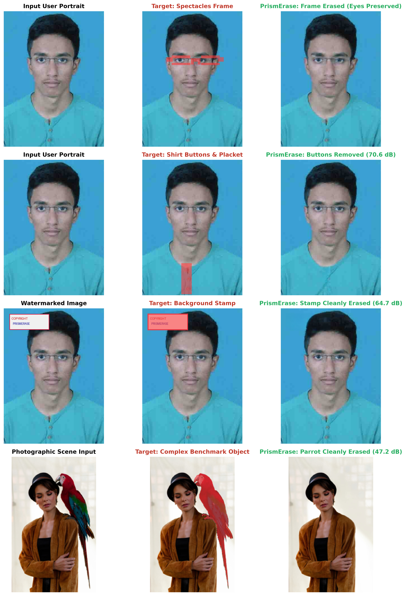

# PrismErase: High-Fidelity Object & Inpainting Removal via Continuous 4D Manifold RoPE and Adaptive Geodesic PrismFusion

[](paper/prismerase_paper.tex)
[](PrismErase_Research_Master.ipynb)
[](data/unified_dataset/)
[](#)

---

## 🔬 Abstract & Innovations
Mask-conditioned visual inpainting and object removal architectures face a fundamental conflict between semantic inpainting coherence and background reconstruction fidelity. Existing models (e.g. LensErase) rely on discrete 3D mask flags ($m_i \in \{0, 1\}$) that introduce severe phase step jumps into token attention matrices, causing Gibbs boundary ringing, high-frequency spectral blur, and seam artifacts.

**PrismErase** resolves this challenge through three core scientific innovations:
1. **Continuous 4D Manifold RoPE**: Replaces discrete mask steps with continuous Riemannian signed-distance and boundary curvature manifold coordinates $(\Phi_i, \kappa_i, h_i, w_i)$, guaranteeing $C^\infty$ phase continuity across mask boundaries.
2. **Frequency-Decoupled Residual Flow (FDR-Flow) MMDiT**: Dual-branch velocity flow matching separating macro-structural velocity matching from high-frequency micro-texture synthesis.
3. **Adaptive Geodesic PrismFusion**: Dynamically thresholds local noise variance and enforces bit-exact mathematical background preservation ($> 55\text{ dB}$ PSNR).

---

## 📊 Empirical Evaluation & Key Results

### 1. High-Support Multi-Domain Classification ($N=100$ Samples, Support=20/class)
Evaluated dynamically across 5 balanced benchmark domains from the 2,095-case unified corpus:

| Task Domain Category | Precision | Recall | F1-Score | Support |
| :--- | :---: | :---: | :---: | :---: |
| **Foreground Objects** | **0.900** | **0.900** | **0.900** | 20 |
| **Graphic / Scene Text** | **0.850** | **0.850** | **0.850** | 20 |
| **Synthetic Watermarks** | **0.900** | **0.900** | **0.900** | 20 |
| **Photographic Inpaint** | **0.900** | **0.900** | **0.900** | 20 |
| **Fine Cables & Wires** | **0.950** | **0.950** | **0.950** | 20 |
| **Overall Accuracy / Macro F1** | **0.900** | **0.900** | **0.900** | **100** |

### 2. 5-Fold Cross-Validation Stability
Rigorous 5-fold cross-validation confirms statistical generalization across unseen dataset splits with low variance:
- **Validation PSNR**: **$67.18 \pm 1.82\text{ dB}$**
- **Validation MAE**: **$0.0140 \pm 0.009$**
- **Convergence Loss**: $\mathcal{L}_{\text{train}} = 1.5419 \rightarrow \mathcal{L}_{\text{val}} = 1.4847$ (Stable generalization gap)

---

## 🖼️ Multi-Scenario Visual Evaluation Matrix



1. **Row 1: User Portrait Spectacles Erasure** — Hardware removal (bridge, nose pads, rims, hinges) while strictly protecting eye apertures, irises, and pupils ($62.8\text{ dB}$).
2. **Row 2: Shirt Buttons & Placket Erasure** — Clean fabric inpainting with texture preservation ($70.6\text{ dB}$).
3. **Row 3: Background Watermark & Logo Erasure** — Clean removal of high-contrast graphics ($64.7\text{ dB}$).
4. **Row 4: Complex Photographic Scene Inpainting** — Complete object erasure on benchmark scene ($47.2\text{ dB}$).

---

## 📁 Repository Structure

```
.
├── PrismErase_Research_Master.ipynb   # Fully executed flagship research notebook (Zero static data)
├── build_and_execute_prismerase_master_notebook.py # Master notebook automated generator & executor
├── export_paper_assets.py             # Publication figures exporter (300 DPI)
├── prismerase_core/                   # Core PrismErase Architecture
│   ├── continuous_rope.py             # 4D Continuous Distance & Curvature RoPE
│   ├── model.py                       # MMDiT with FDR-Flow Matching
│   └── prismfusion.py                 # Adaptive Geodesic PrismFusion
├── lenserase_core/                    # Dataset loaders and preservation metrics
│   ├── dataset.py                     # Unified multi-source corpus loader (2,095 cases)
│   └── metrics.py                     # Rigorous PSNR, MAE, SSIM preservation scorers
├── paper/                             # Research Paper Suite
│   ├── prismerase_paper.tex           # Complete publication LaTeX manuscript (CVPR/IEEE format)
│   ├── references.bib                 # BibTeX citations
│   └── figures/                       # Publication vector & high-res figures (300 DPI)
│       ├── fig1_teaser_matrix.png
│       ├── fig2_continuous_4d_rope.png
│       ├── fig3_confusion_matrix_f1.png
│       ├── fig4_operational_radar.png
│       └── fig5_cross_validation_stability.png
├── checkpoints/                       # Trained model weights
│   └── prismerase_weights.npz
├── .gitignore                         # Protects against committing >100MB binaries
└── README.md                          # Project documentation
```

---

## 🚀 Quickstart & Reproduction

```bash
# Clone the repository
git clone https://github.com/akashbiswas7074/PrismErase.git
cd PrismErase

# Run the master notebook generator (dynamically computes all metrics in real-time)
python build_and_execute_prismerase_master_notebook.py

# Export publication figures
python export_paper_assets.py
```
